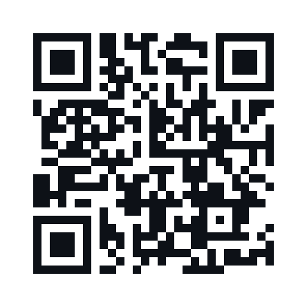
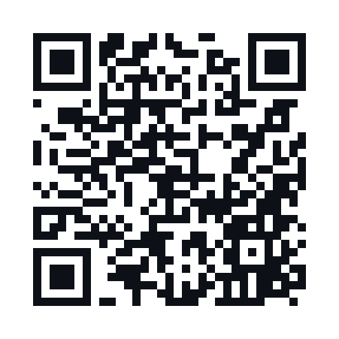
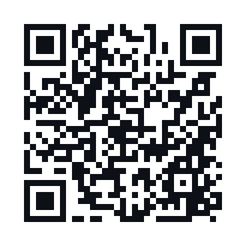

# Accesos rápidos — Mis Archivos, Grabar voz y Cámara

Enlaces y códigos QR para abrir las tres páginas desde cualquier equipo o celular.
Las tres guardan en el mismo disco del PC (`E:\Archivos`).

Página: **https://wroso1.github.io/accesos-pc/**

## 1. Mis Archivos — pide clave

- Enlace: https://mini-pc.tail26ccb2.ts.net/media/
- Fotos, videos y grabaciones de voz, con miniaturas y descarga.

## 2. Grabar voz — sin clave

- Enlace: https://mini-pc.tail26ccb2.ts.net/media/grabar
- Graba con el micrófono y se guarda sola en el PC. Las grabaciones se escuchan en la pestaña *Grabaciones de voz* de Mis Archivos.

## 3. Cámara — sin clave

- Enlace: https://mini-pc.tail26ccb2.ts.net/media/camara
- Toma fotos o graba video con la cámara del celular, o sube archivos que ya tengas.

## Notas

- Para dejarlas como app en el celular: abrir la página → **Agregar a pantalla de inicio** (iPhone: Compartir → Añadir a pantalla de inicio).
- Si el PC está apagado o sin conexión, los enlaces no responden.
- Las páginas se sirven por Tailscale Funnel, con HTTPS y certificado válido.
